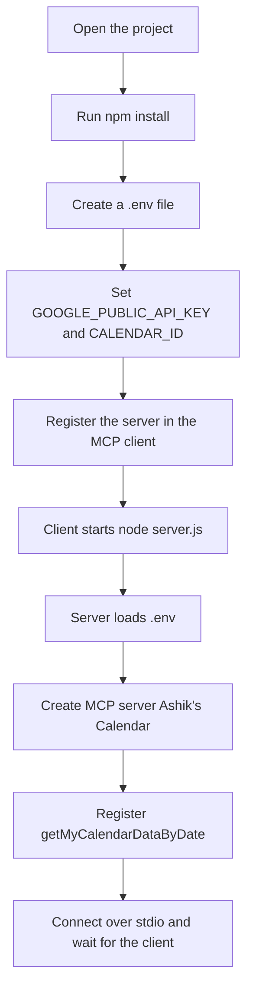
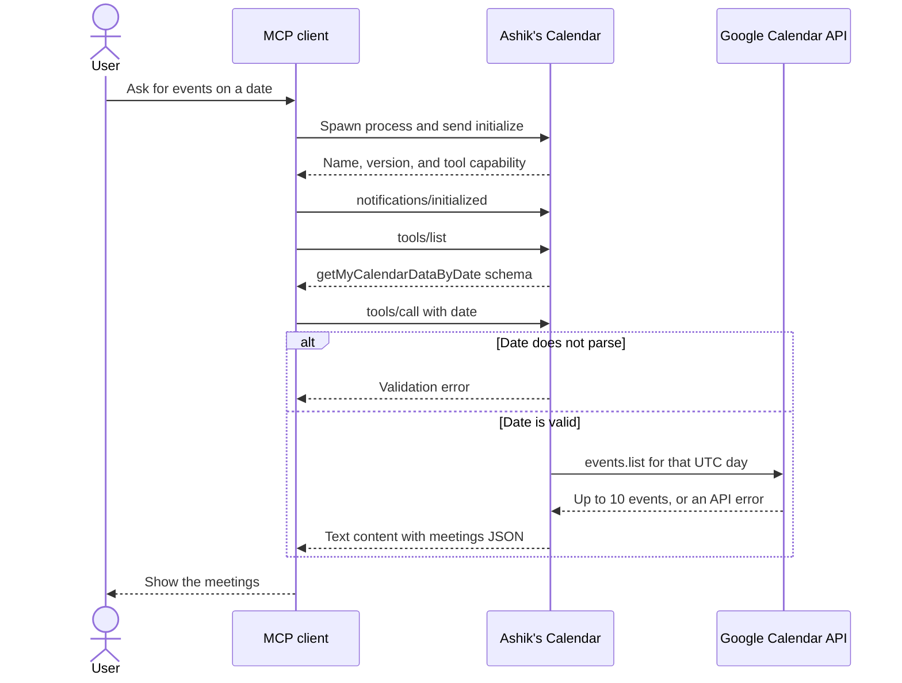

# Ashik's Calendar

A small [Model Context Protocol](https://modelcontextprotocol.io) server that looks up events on a Google Calendar for a given date.

An MCP client (such as Cursor) starts this process and talks to it over stdio. The server exposes one tool, `getMyCalendarDataByDate`.

## What the tool does

`getMyCalendarDataByDate` takes a `date` string and returns events for that UTC day:

- The date must parse with `Date.parse`.
- The window is midnight UTC through the next midnight.
- Up to 10 events are returned, ordered by start time, as `"title at start time"`.
- An empty list means nothing is scheduled that day.
- API failures come back as `{ "error": "..." }`.

## Setup

```bash
npm install
```

Create a `.env` file in the project root (it is gitignored):

```
GOOGLE_PUBLIC_API_KEY=your_google_api_key
CALENDAR_ID=your_calendar_id
```

The calendar must be readable with that API key. A public calendar works with a public API key.

## Run

```bash
npm start
```

That runs `node server.js`. The process waits on stdin for MCP messages, so it looks idle if you start it in a terminal by itself. Point your MCP client at this folder's `server.js` instead.

## Setup flow



## How it talks to an MCP client

The client owns the process. It starts `server.js`, then sends JSON-RPC messages on stdin and reads replies from stdout. This server does not open a port.



## Tech stack

- Node.js (ES modules)
- [@modelcontextprotocol/sdk](https://modelcontextprotocol.io) — MCP server and stdio transport
- [googleapis](https://github.com/googleapis/google-api-nodejs-client) — Google Calendar v3
- [zod](https://zod.dev) — tool input validation
- [dotenv](https://github.com/motdotla/dotenv) — loads `.env`
