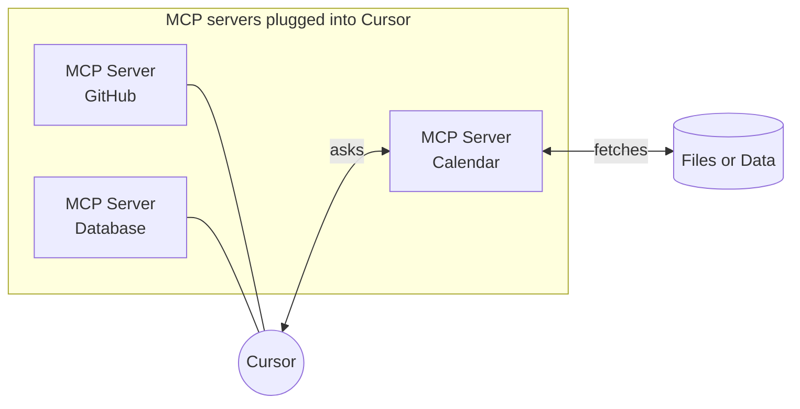
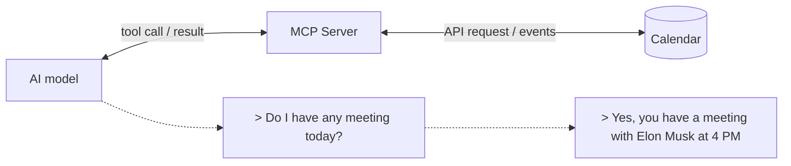
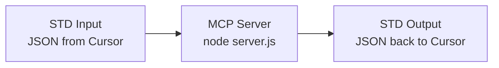
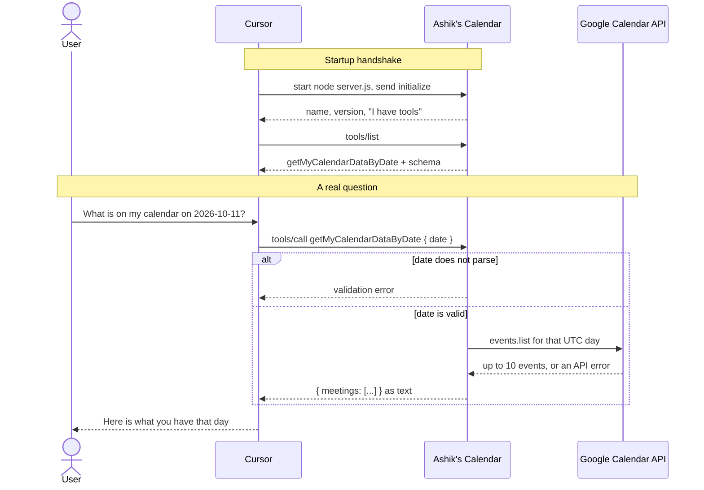
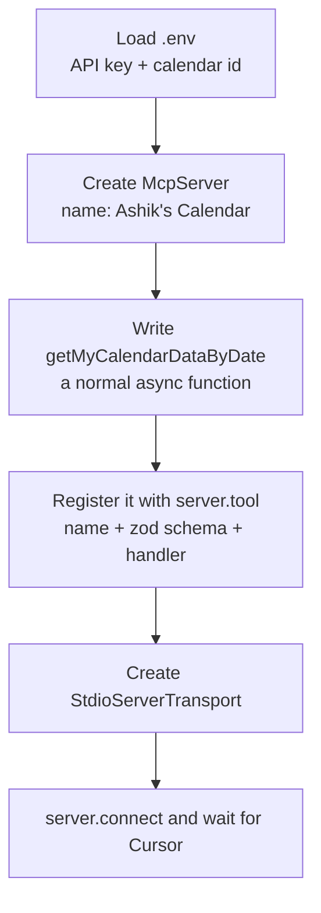
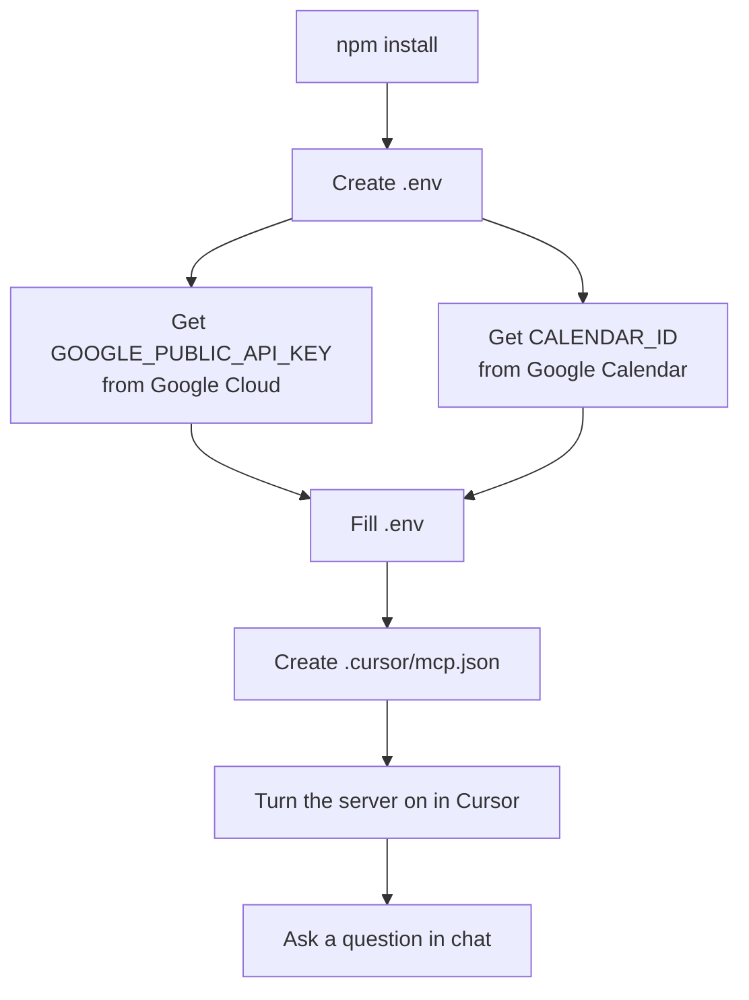

# Ashik's Calendar — my first MCP server

This is a small Node.js program that lets Cursor read my Google Calendar. I built it to learn how MCP works, so this README is written as a note to myself: what MCP is, how Cursor talks to it, how this project uses that, and how to set it up again from zero.

If you only want to run it, jump to [Part 4: Setup](#part-4-setup). If you want to understand it, start at the top.

---

## Part 1: What is MCP?

### The problem

An AI model only knows two things: what it learned during training, and what you type in the chat. It cannot see your calendar. It cannot open your files. It cannot query your database. Ask it "do I have a meeting today?" and it has to guess.

### The idea

**MCP** stands for **Model Context Protocol**. It is a shared language that lets an AI app ask a small outside program for help, and get an answer back.

The simplest way to picture it is a USB port.

- Cursor is the laptop.
- Each MCP server is a device you plug in.
- The laptop does not care how the device works inside. It only needs the port to speak the same language.

One laptop can have many devices plugged in at once. Cursor works the same way: it can run several MCP servers side by side, each one reaching a different source of data.



### What is an MCP server, then?

An MCP server is just a program that offers **tools**. A tool is a function with three parts:

| Part | Meaning | In this project |
|---|---|---|
| Name | What the AI calls it | `getMyCalendarDataByDate` |
| Input schema | What it needs | a `date` string |
| Handler | What it does | asks Google Calendar for that day |

The AI reads the list of tools, picks one, fills in the input, and waits for the result. The server does the real work in plain code. No AI knowledge is needed to write one.

### Why bother?

- The AI gets live data instead of guessing.
- You decide what it can reach. This server can only read one calendar, nothing else.
- Write it once, use it in any MCP client, not only Cursor.

---

## Part 2: How Cursor talks to an MCP server

### The conversation

Here is the whole story in one picture. You ask a question. The AI realises it has a tool for that. The server fetches the data. The AI turns it into a sentence.



Step by step:

1. You type "Do I have any meeting today?" in Cursor.
2. The AI looks at its tools and sees one that returns calendar events for a date.
3. Cursor sends a tool call to the MCP server with today's date.
4. The server asks the Google Calendar API for that day.
5. Google answers. The server passes the events back to Cursor.
6. The AI writes a normal reply: "Yes, you have a meeting at 4 PM."

### The pipe: STDIO

How do the messages travel between Cursor and the server? This server does not open a web port. It uses **STDIO**, standard input and standard output.



You already use stdio every day. When you type `echo "Hello"` in a terminal, the word comes back through standard output:

```
→ ~ echo "Hello"
Hello
```

MCP uses the same two pipes. Cursor starts `node server.js` as a child process, writes JSON messages into its stdin, and reads JSON replies from its stdout. That is also why the server looks frozen when you run `npm start` by hand. It is not stuck. It is waiting for someone to write to stdin.

### The handshake

Under the hood the first few messages are always the same. Cursor says hello, the server introduces itself and lists its tools, and only then do real tool calls begin.



---

## Part 3: How this project works

Everything lives in one file, `server.js`. Read it top to bottom and it tells the same story as Part 2.



### 1. Create the server

```js
import { McpServer } from "@modelcontextprotocol/sdk/server/mcp.js";

const server = new McpServer({
    name: "Ashik's Calendar",
    version: "1.0.0",
});
```

This is the "device" from Part 1. The name is what Cursor shows in its MCP list.

### 2. Write a normal function that fetches data

```js
async function getMyCalendarDataByDate(date) {
    const calendar = google.calendar({
        version: "v3",
        auth: process.env.GOOGLE_PUBLIC_API_KEY,
    });

    // the whole UTC day
    const start = new Date(date);
    start.setUTCHours(0, 0, 0, 0);
    const end = new Date(start);
    end.setUTCDate(end.getUTCDate() + 1);

    const res = await calendar.events.list({
        calendarId: process.env.CALENDAR_ID,
        timeMin: start.toISOString(),
        timeMax: end.toISOString(),
        maxResults: 10,
        singleEvents: true,
        orderBy: "startTime",
    });

    const meetings = res.data.items.map(
        (event) => `${event.summary} at ${event.start.dateTime || event.start.date}`
    );
    return { meetings };
}
```

Nothing MCP-specific here. It is a plain Google Calendar call. If the API fails, the real code catches the error and returns `{ error: "..." }` instead.

### 3. Register it as a tool

```js
server.tool(
    "getMyCalendarDataByDate",
    {
        date: z.string().refine((val) => !isNaN(Date.parse(val)), {
            message: "Invalid date format. Please provide a valid date string.",
        }),
    },
    async ({ date }) => ({
        content: [
            { type: "text", text: JSON.stringify(await getMyCalendarDataByDate(date)) },
        ],
    })
);
```

This is the part that turns the function into something the AI can see. Three arguments:

- the **name** the AI will call,
- the **input schema** (Zod checks that `date` really parses),
- the **handler** that runs on each call and must return `content`.

### 4. Connect over stdio

```js
import { StdioServerTransport } from "@modelcontextprotocol/sdk/server/stdio.js";

const transport = new StdioServerTransport();
await server.connect(transport);
```

After this line the process just waits. Cursor will write to its stdin when it has a question.

### What the tool returns

- Events for the whole **UTC day**: `00:00` UTC through the next midnight. In Malaysia time (UTC+8) that window runs from 8:00am on that date to 8:00am the next morning.
- Up to 10 events, ordered by start time, as `"title at start time"`.
- An empty `meetings` list means nothing is scheduled.
- `{ "error": "..." }` means the Google call failed.

---

## Part 4: Setup

The order below matches the picture: install, get two secrets from Google, put them in `.env`, then tell Cursor how to start the server.



### 4.1 Install

```bash
npm install
```

### 4.2 Create `.env`

In the project root, create a file called `.env`. It is gitignored, so it never gets committed.

```
GOOGLE_PUBLIC_API_KEY=
CALENDAR_ID=
```

### 4.3 Get `GOOGLE_PUBLIC_API_KEY`

This server reads the calendar with a public API key. You do not need the Google Cloud free trial or a credit card.

1. Open [Google Cloud Console](https://console.cloud.google.com/) and select or create a project.
2. Menu → **APIs & Services → Library**.
3. Search **Google Calendar API** (the card that says "Manage calendars and events in Google Calendar") and click **Enable**. Leave Calendar MCP API, CalDAV API, and Workspace MCP API alone.
4. Menu → **APIs & Services → Credentials → Create credentials → API key**.
5. Give it a name. Under **Select API restrictions**, tick **Google Calendar API**.
6. Under **Application restrictions**, choose **None**. Websites, IP addresses, Android, and iOS would all block a local Node process.
7. Click **Create**, copy the key, and paste it after `GOOGLE_PUBLIC_API_KEY=`.

### 4.4 Get `CALENDAR_ID`

A public API key can only read a **public** calendar. This id comes from Google Calendar, not Google Cloud.

1. Open [Google Calendar](https://calendar.google.com/) → gear icon → **Settings**.
2. Create a new calendar, or pick one under **Settings for my calendars**.
3. Open it. Under **Access permissions for events**, turn on **Make available to public** and choose **See all event details**. Free/busy only would hide the event titles.
4. Scroll to **Integrate calendar** and copy **Calendar ID**. It looks like `you@gmail.com` or `abc123@group.calendar.google.com`.
5. Paste it after `CALENDAR_ID=` and save `.env`.

### 4.5 Tell Cursor how to start the server

Create `.cursor/mcp.json` in the project root:

```json
{
  "mcpServers": {
    "ashik-calendar": {
      "command": "node",
      "args": ["${workspaceFolder}/server.js"]
    }
  }
}
```

The secrets stay in `.env`. This file only says "run `node server.js` from this folder". `${workspaceFolder}` is replaced with the project path, so the same file works on any machine.

Then in Cursor: **Settings → Customize → MCPs**, find **ashik-calendar**, and switch it on. Cursor starts the process itself. You do not need `npm start` running in a terminal.

### Running by hand (optional)

```bash
npm start
```

This runs `node server.js`. It will look idle. That is stdio waiting for input, as explained in Part 2.

---

## Part 5: Check that it works

### Is it connected?

1. **Settings → Customize → MCPs**.
2. **ashik-calendar** is listed and switched on.
3. Open it. The tool `getMyCalendarDataByDate` is listed.

If it is missing or red, reload the window, then open the Output panel (`Ctrl+Shift+U`) and pick **MCP Logs**. The error for `ashik-calendar` is there.

### Does it answer?

In a new Agent chat, ask:

> What is on my calendar on 2026-10-11?

Cursor should call `getMyCalendarDataByDate`. An empty `meetings` list still counts as success: the server ran and Google answered. An `error` field means the key, the calendar id, or the public setting is wrong.

---

## Part 6: Adding more servers

`mcpServers` is a map, so one `.cursor/mcp.json` can hold many servers. Each key gets its own toggle in Cursor. A local program uses `command` and `args`. A hosted one uses `url`.

```json
{
  "mcpServers": {
    "ashik-calendar": {
      "command": "node",
      "args": ["${workspaceFolder}/server.js"]
    },
    "second-server": {
      "command": "npx",
      "args": ["-y", "some-mcp-package"]
    },
    "remote-server": {
      "url": "https://example.com/mcp"
    }
  }
}
```

---

## Tech stack

- Node.js (ES modules)
- [@modelcontextprotocol/sdk](https://modelcontextprotocol.io) — MCP server and stdio transport
- [googleapis](https://github.com/googleapis/google-api-nodejs-client) — Google Calendar v3
- [zod](https://zod.dev) — tool input validation
- [dotenv](https://github.com/motdotla/dotenv) — loads `.env`
