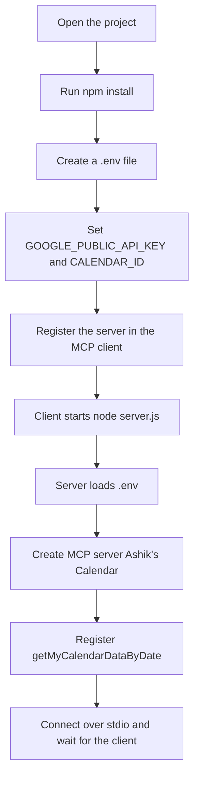
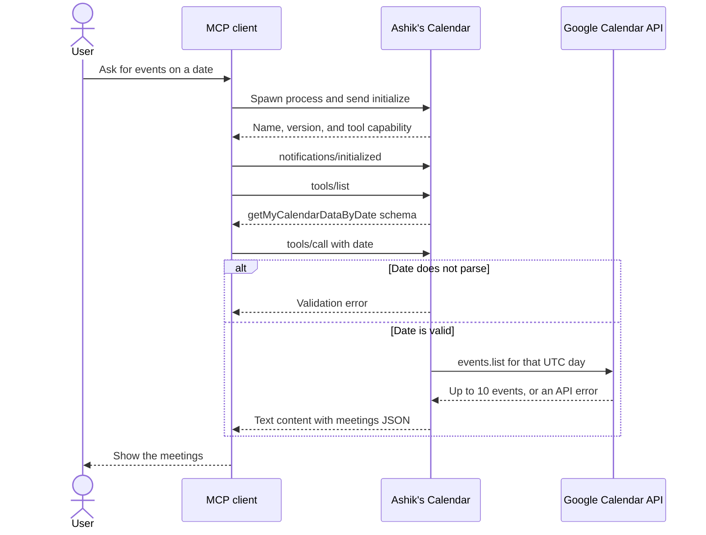

# Ashik's Calendar

A small [Model Context Protocol](https://modelcontextprotocol.io) server that looks up events on a Google Calendar for a given date.

An MCP client (such as Cursor) starts this process and talks to it over stdio. The server exposes one tool, `getMyCalendarDataByDate`.

## What the tool does

`getMyCalendarDataByDate` takes a `date` string and returns events for that UTC day:

- The date must parse with `Date.parse`.
- The window is midnight UTC through the next midnight.
- Up to 10 events are returned, ordered by start time, as `"title at start time"`.
- An empty list means nothing is scheduled that day.
- API failures come back as `{ "error": "..." }`.

## Setup

```bash
npm install
```

Create a `.env` file in the project root (it is gitignored):

```
GOOGLE_PUBLIC_API_KEY=
CALENDAR_ID=
```

### `GOOGLE_PUBLIC_API_KEY`

This server calls the Google Calendar API with a public API key. You do not need the Google Cloud free trial or a credit card.

1. Open [Google Cloud Console](https://console.cloud.google.com/) and select or create a project.
2. Open the menu and go to **APIs & Services → Library**.
3. Search for **Google Calendar API** (the card that says "Manage calendars and events in Google Calendar") and click **Enable**. Leave Calendar MCP API, CalDAV API, and Workspace MCP API alone.
4. Go to **APIs & Services → Credentials → Create credentials → API key**.
5. Name the key, then under **Select API restrictions** choose **Google Calendar API**.
6. Under **Application restrictions**, choose **None**. Websites, IP addresses, Android, and iOS would block this local Node process.
7. Click **Create** and copy the key into `GOOGLE_PUBLIC_API_KEY`.

### `CALENDAR_ID`

A public API key can only read a calendar that is public. Get the id from Google Calendar, not from Google Cloud.

1. Open [Google Calendar](https://calendar.google.com/) → gear icon → **Settings**.
2. Create a calendar, or pick one under **Settings for my calendars**.
3. Open that calendar. Under **Access permissions for events**, turn on **Make available to public** and choose **See all event details**. Free/busy sharing hides event titles.
4. Scroll to **Integrate calendar** and copy **Calendar ID**. It looks like `you@gmail.com` or `abc123@group.calendar.google.com`.
5. Paste it into `CALENDAR_ID` and save `.env`.

Do not commit `.env`. The primary calendar id is usually your Gmail address.

## Run

```bash
npm start
```

That runs `node server.js`. The process waits on stdin for MCP messages, so it looks idle if you start it in a terminal by itself. Cursor starts its own copy from the config below, so you do not need `npm start` running in a terminal.

## Connect to Cursor

1. In the project root, create `.cursor/mcp.json`.
2. Paste this. The API key and calendar id stay in `.env`, not in this file.

```json
{
  "mcpServers": {
    "ashik-calendar": {
      "command": "node",
      "args": ["${workspaceFolder}/server.js"]
    }
  }
}
```

3. Save the file.
4. In Cursor, open **Settings → Customize → MCPs** (or click **Open Customize** on the settings banner).
5. Turn on **ashik-calendar**.

Cursor starts `node server.js` over stdio and loads `.env` from this folder. You do not need `npm start` running in a terminal for this.

### Check that it is connected

1. Open **Settings → Customize → MCPs**.
2. **ashik-calendar** should be listed and switched on.
3. Open that server. The tool `getMyCalendarDataByDate` should be listed.

If the server is missing or shown in red, reload the window. Then open the Output panel (`Ctrl+Shift+U`) and choose **MCP Logs**. Read the error for `ashik-calendar`.

### Check that it returns events

In a new Agent chat, ask for a date, for example:

> What is on my calendar on 2026-10-11?

Cursor should call `getMyCalendarDataByDate`. An empty `meetings` list still means the server ran. An `error` field means the API key, calendar id, or public-calendar setting is wrong.

The date is a UTC day (`00:00` UTC through the next midnight). In Malaysia time (UTC+8) that window starts at 8:00am on that date and ends at 8:00am the next morning.

### More than one server

`mcpServers` is a map. Each key is a separate server with its own toggle. A local program uses `command` and `args`. A hosted server uses `url`.

```json
{
  "mcpServers": {
    "ashik-calendar": {
      "command": "node",
      "args": ["${workspaceFolder}/server.js"]
    },
    "second-server": {
      "command": "npx",
      "args": ["-y", "some-mcp-package"]
    },
    "remote-server": {
      "url": "https://example.com/mcp"
    }
  }
}
```

## Setup flow



## How it talks to an MCP client

The client owns the process. It starts `server.js`, then sends JSON-RPC messages on stdin and reads replies from stdout. This server does not open a port.



## Tech stack

- Node.js (ES modules)
- [@modelcontextprotocol/sdk](https://modelcontextprotocol.io) — MCP server and stdio transport
- [googleapis](https://github.com/googleapis/google-api-nodejs-client) — Google Calendar v3
- [zod](https://zod.dev) — tool input validation
- [dotenv](https://github.com/motdotla/dotenv) — loads `.env`
